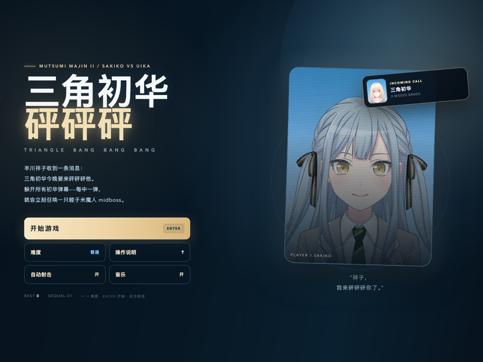
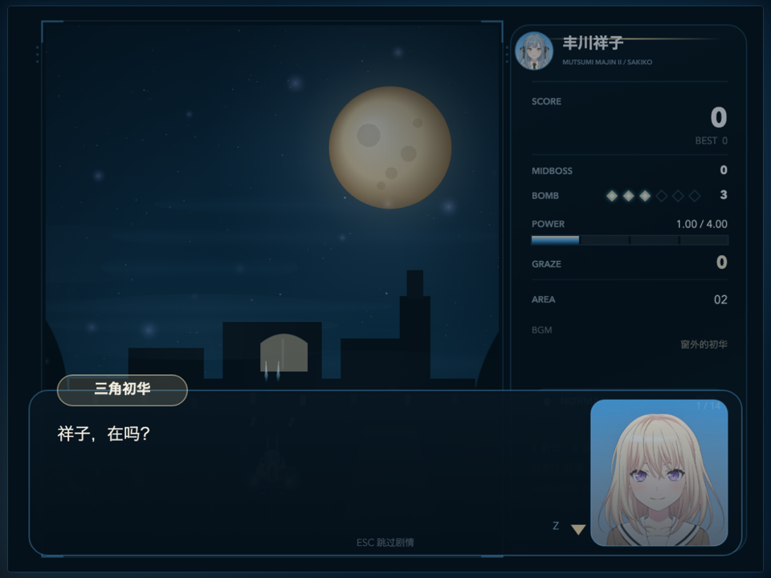
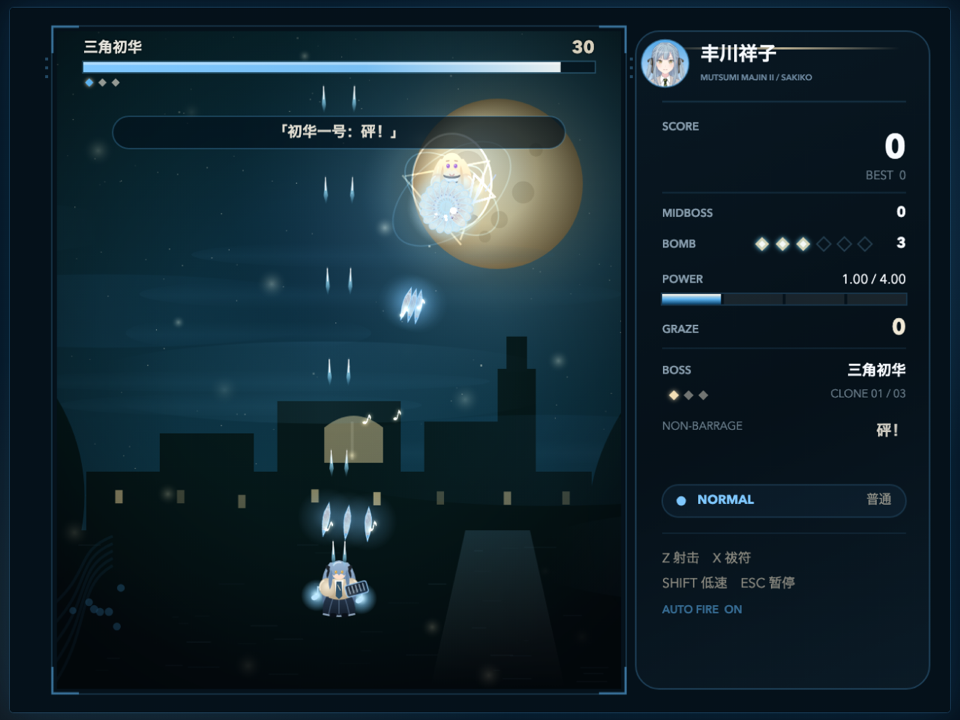
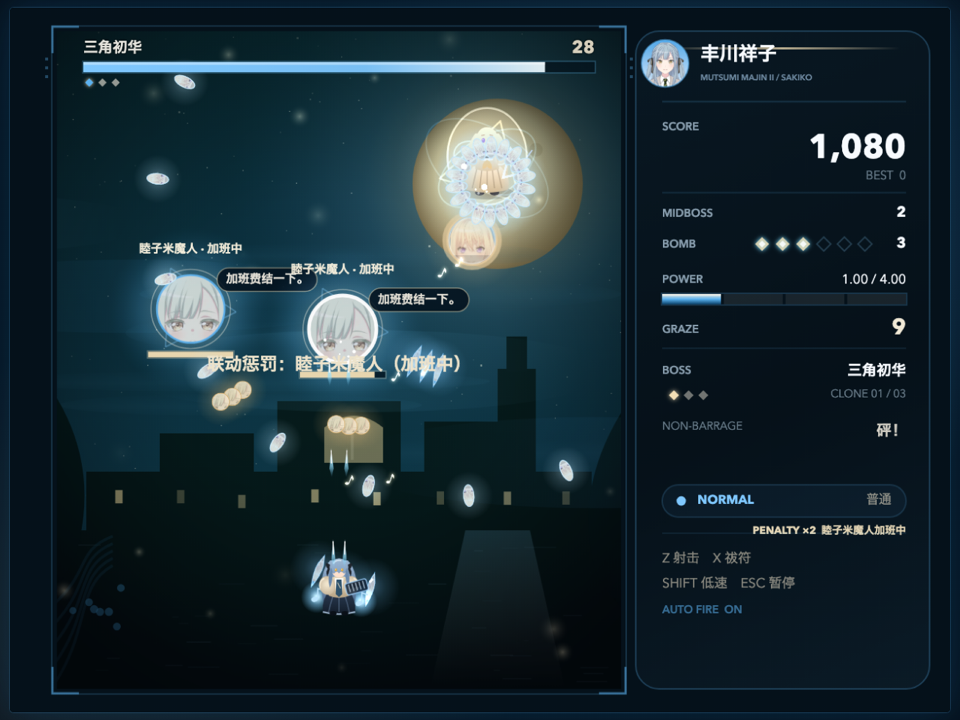
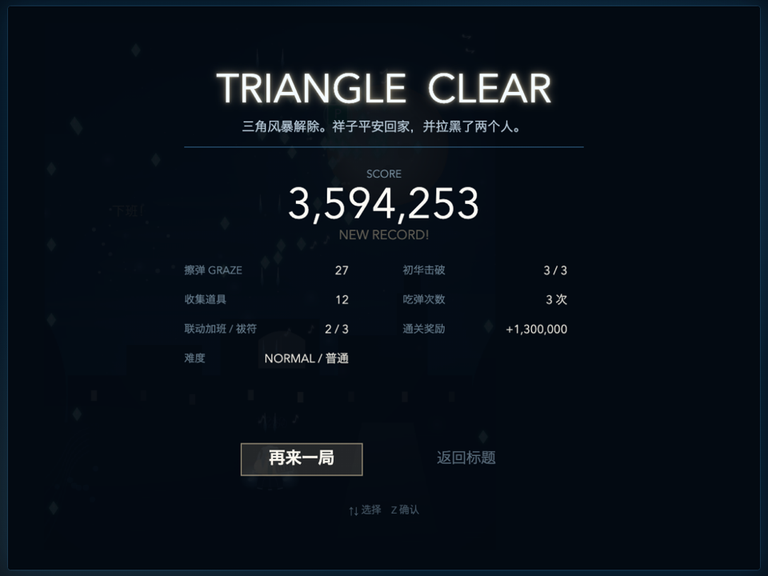

# 睦子米魔人 II ～ 三角初华砰砰砰

**MUTSUMI MAJIN II: TRIANGLE BANG BANG BANG**

《睦子米魔人》的续作。主角是**丰川祥子**；某天晚上，祥子收到一条消息：三角初华要来**砰砰砰**她。

- 躲开所有以**三角初华**的脸做成的弹幕。
- 每中一弹，都会**立刻**召唤一只**睦子米魔人头像的 midboss（加班中）**。
- 击破全部**三个三角初华**即可通关。midboss 不强制击破，但它们会一直开火。

## 运行

直接双击 `index.html` 即可；也可以使用本地服务器：

```bash
cd mutsumi-majin-2
python3 -m http.server 8138 --bind 127.0.0.1
```

打开 **http://127.0.0.1:8138/play.html**。

macOS 可双击 `启动游戏.command`；Windows 可双击 `启动游戏.bat`。

## 操作

| 操作 | 按键 |
| --- | --- |
| 移动 | 方向键 / WASD / 左摇杆 |
| 射击 | Z（默认自动射击） |
| 祓符 | X（清弹、无敌、造成伤害） |
| 低速 | Shift（显示判定点） |
| 暂停 | Esc / P |
| 跳过剧情 | Esc |
| 触屏 | 画面内拖动，右下面板按钮 |

## 没有生命系统

本作**没有生命 / 残机**。吃到弹幕：

- 不会扣命，不会死亡，不会中断关卡；
- 只会立刻召唤一只**睦子米魔人（加班中）**；
- 之后有短暂无敌，避免同一瞬间连续判定；
- 每次受击都会增加一只，同时最多 3 只，超过时最旧的一只“换班”。

结算里显示的是「吃弹次数」与「联动加班」次数，不再有残机统计。

## 核心机制

1. **三角初华 · 三个克隆**
   - 战斗分为 `CLONE 01 / 03`、`02 / 03`、`03 / 03` 三个阶段。
   - 每个阶段都有独立的“砰 / 砰砰 / 砰砰砰”弹幕。
   - 击破全部三个克隆才算通关。

2. **吃弹 → 召唤 midboss**
   - 祥子每被弹幕击中一次，立即生成一只**睦子米魔人头像**的 midboss。
   - midboss 会发射米黄色的睦子米脸弹幕，并持续追击。
   - 同时最多存在 3 只；超过时最旧的一只会“换班”。
   - 击破 midboss 可以获得分数与道具，但**不强制**；只要击破三个三角初华就能通关。
   - 通关时所有加班的睦子米会一起“下班”。

3. **弹幕全部是脸**
   - 三角初华的弹幕使用你上传的初华图片，经过裁切/拉伸成不同弹型。
   - 睦子米 midboss 的弹幕使用睦子米图片（米黄色）。
   - 祥子的自机弹是蓝白音符与音符选项。

## 剧情

偏向荒诞、无厘头的小尬剧：

- 祥子收到初华的消息：“我今晚要来砰砰砰你。”
- 初华带了“三个我”：一个负责砰，一个负责砰砰，还有一个负责善后。
- 根据《睦子米魔人》联动协议，祥子每中一弹，庭园就会派一名睦子米魔人加班，加班费由祥子承担。
- 通关后初华解释：其实只是想见祥子，但直接说太害羞，所以用了点弹幕。
- 睦子米在终章追讨加班费，初华和祥子都回答“下次一定”。

完整对话可用 `Z / Enter` 或鼠标点击推进，`Esc` 跳过整段。

## 截图











## 目录

```
mutsumi-majin-2/
├── index.html            主菜单
├── play.html             强制最新入口
├── style.css             标题 / 帮助界面
├── assets/
│   ├── shoko.webp        丰川祥子（主角头像 / HUD）
│   ├── uika.webp         三角初华（Boss 头像 / 弹幕）
│   └── mutsumi.webp      睦子米（惩罚 midboss 头像 / 弹幕）
├── js/
│   ├── util.js           工具与天蓝/米黄弹幕色板
│   ├── input.js          键鼠 / 触屏
│   ├── audio.js          程序化 BGM / 音效
│   ├── art.js            祥子、初华、弹幕、背景
│   ├── bullets.js        弹幕池（支持双图片弹幕）
│   ├── player.js         祥子自机 / 音符弹
│   ├── boss.js           三个三角初华阶段
│   ├── stage.js          背景与舞台
│   ├── penalty.js        睦子米惩罚 midboss
│   └── game.js           流程、剧情、HUD、结算
├── screenshots/
├── 启动游戏.command
├── 启动游戏.bat
└── package.json
```

## 调试参数

- `?scene=title`
- `?scene=play` / `?scene=boss` / `?scene=spell&phase=0..2`
- `?scene=midboss`（直接生成一只睦子米惩罚 midboss）
- `?scene=dialogue` / `?scene=result` / `?scene=gameover`
- `?god=1` 无敌
- 控制台可用 `__game.debugStep(n)` 手动推进帧。

## 说明

- 纯 HTML / CSS / Canvas 2D，零构建、零第三方依赖，`file://` 和 HTTP 都能玩。
- 角色图片来自你上传的素材；弹幕会把图片裁切/拉伸成 `orb / rice / knife / bubble` 等弹型。
- 与第一部《睦子米魔人》是两个独立目录，存档 key 也分开（`mm2_best_v1` / `mm2_settings_v1`）。
