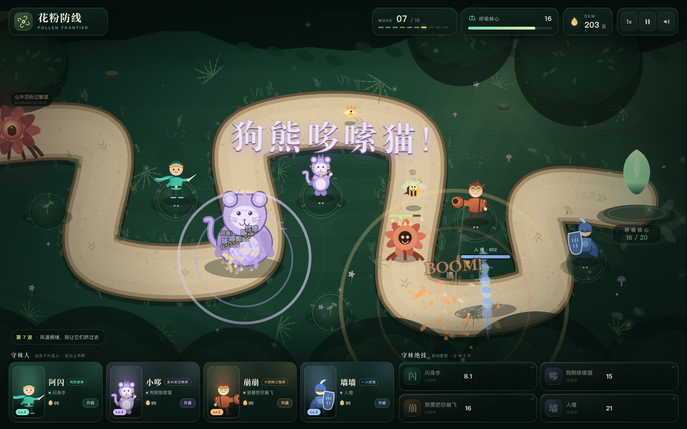

# 花粉防线 · Pollen Frontier

一款关于呼吸的塔防小游戏。

山木花粉过敏源顺着风道涌来。把四位画风不太统一的守林人放上花台，用他们的绝技守住最后的呼吸核心。

## 怎么玩

双击 `index.html`，或运行 `启动游戏.command`（macOS）/ `启动游戏.bat`（Windows）。

不需要安装依赖，也不需要联网。

### 操作

- **1–4**：选择守林人
- 选中后 **点击发光花台**：布阵
- 点击已布阵的卡片 / 花台：查看射程，点击卡片上的 **升级** 强化
- **Q / W / E / R**：释放对应绝技（自动索敌）
- **空格**：暂停 / 继续
- **F**：切换 1× / 2× / 3× 速度
- **Esc**：取消选择

每波开始前可以按 **催花迎战** 提前出战，剩余的准备时间会折成额外露珠。击败花粉获得露珠，用来布阵和升级。

## 四位守林人

| 守林人 | 绝技 | 定位 |
| --- | --- | --- |
| 阿闪 | **闪身步** | 高速单体。瞬身到最前方敌群连斩，留下 4 秒破绽（受到伤害提高）。 |
| 小哆 | **狗熊哆嗦猫** | 控制 / 范围。召唤发抖的巨猫熊砸地，震晕并让花粉发抖、减速、易伤。 |
| 崩崩 | **我要把你崩飞** | 爆发。一炮轰向最密集的花粉堆，造成范围伤害并把它们沿风道崩退。 |
| 墙墙 | **人墙** | 阻挡。在风道上召唤一排不愿透露姓名的墙，拦住花粉并替核心挨打。 |

四个人各有一个常驻普攻和一个主动绝技。绝技有独立冷却，需要先布阵才能使用。

## 进攻方

山木花粉过敏源会派出飘絮、绒球、疾刺、蜂媒等花粉。第八波会出现蕊卫，第十波是本体 **山木 · 万蕊母株**。母株会不断从身边散出新的花粉。

呼吸核心初始 20 点呼吸。花粉走到风道尽头就会消耗呼吸，呼吸归零则守林失败。

## 文件

- `index.html` — 页面结构
- `style.css` — 界面、光效和响应式布局
- `game.js` — 战斗逻辑、敌人 AI、角色绘制、粒子与音效
- `screenshots/` — 预览图

游戏使用 Canvas 2D + Web Audio 实时合成音效，没有外部素材依赖。竖屏手机会提示横过来游玩。
