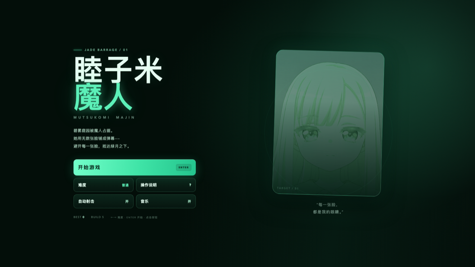
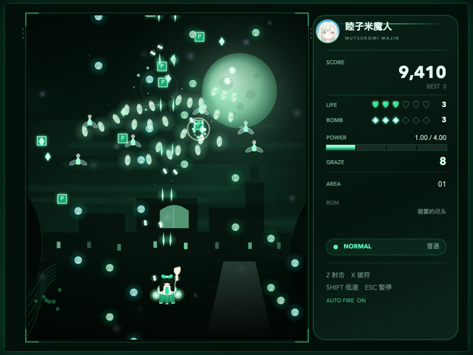
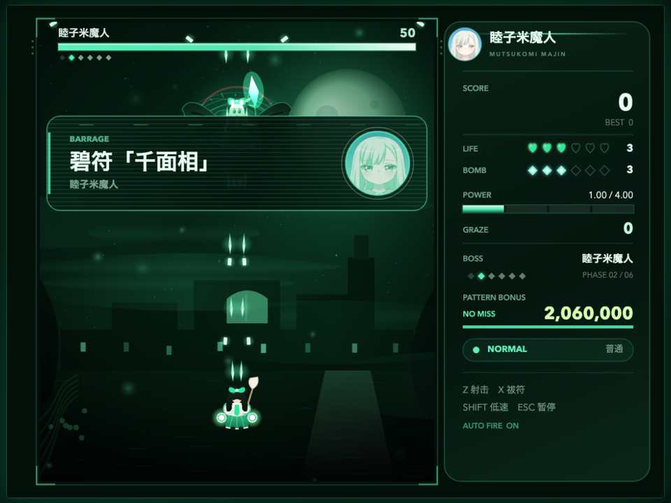
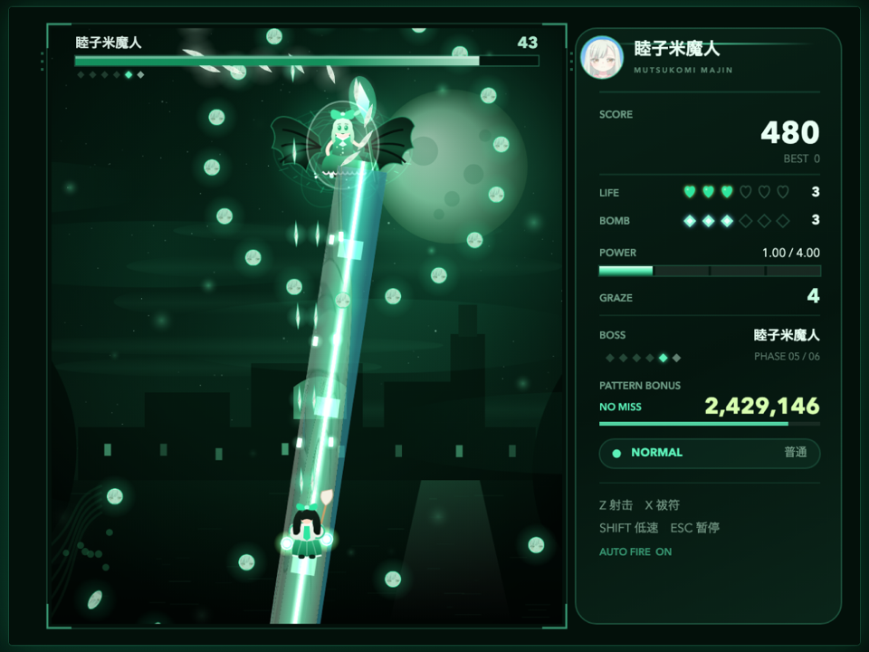
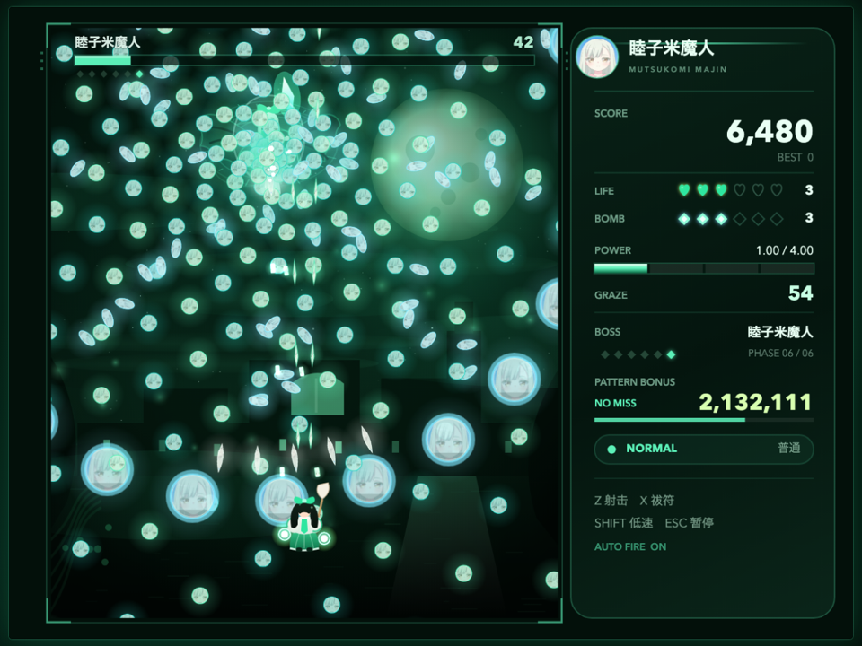
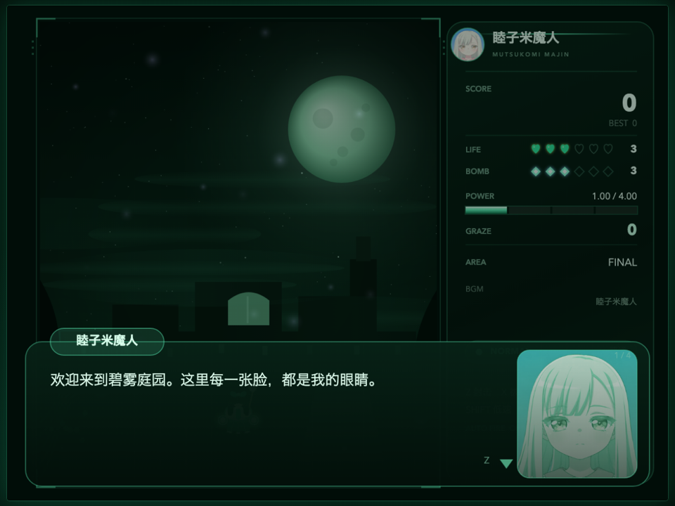
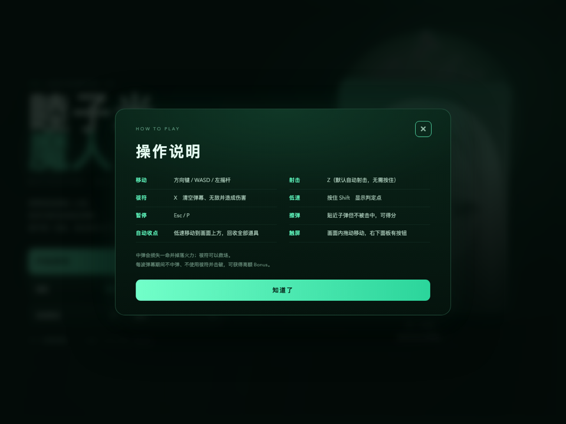

# 睦子米魔人 ～ Mutsumi Majin

一款**碧绿主题的浏览器纵版弹幕射击游戏**。雾气弥漫的庭园里，魔人把无数张脸铺成弹幕——避开它们，穿过绿月之下的弹幕网。

单关卡完整流程：道中妖精 → 中 BOSS **霜见** → 最终 BOSS **睦子米魔人**。
低判定点、擦弹、祓符、阶段奖励、自动收点、四种难度，以及序章、中 BOSS 战前战后、最终 BOSS 各阶段与终章的完整剧情对话——全部零构建、零第三方依赖。



## 剧情

碧雾庭园，原本是一座普通庭园。后来它被改造成了一个**没有营业执照的沉浸式人脸主题乐园**，差评率百分之九十八——剩下的百分之二，没有脸给差评。

这是一出偏向**荒诞、搞笑、无厘头**的小尬剧，全程约 80+ 句对话：

- **祓使 翠**：被派来净化庭园的祓使，表情很少，吐槽很多。今天的 KPI 是祓除一个魔人，结果遇到了一整个客服团队。
- **睦子米魔人**：自称“米总”“碧雾庭园主理人”“首席面部资产管理师”。她没有自己的脸，于是把客人的脸做成会员资产、弹幕素材和年卡赠品。
- **霜见**：庭园前台兼保安，三百年工龄的 unpaid intern。脸被老板收走当押金，合同也是一张脸，签完就被收走了。

剧情流程：

1. **序章**：翠走进碧雾，被当成客人推销会员卡、脸险和“前男友的脸”。
2. **霜见战前**：前台坚持要走流程，翠被迫和一位没有脸、没有工资、没有转正希望的前台打一场。
3. **霜见战后**：霜见提供关键情报：停车费、五星好评、以及老板说的每一句话都别信。
4. **睦子米战前**：长达二十多句的商务洽谈，内容包括年卡、脸熟、祓除体验官和很帅但挂住角的姿势。
5. **六个阶段**：每阶段都有赞助商口播、员工内购会和“最后一张脸”的压轴推销。
6. **终章**：魔人被打败后开始走退款流程，霜见在远处追讨工资，庭园深处传来“记得关灯”的声音。

对话用 `Z / Enter` 或鼠标点击逐句推进；**按 `Esc` 可以跳过整段剧情**。

## 运行

### 方式一：直接打开

双击 `index.html` 即可游玩。所有脚本都是经典 `<script>`，无需服务器或构建。

### 方式二：本地服务器（推荐）

```bash
cd scarlet-danmaku
python3 -m http.server 8137
# 浏览器打开 http://127.0.0.1:8137/
```

macOS 可双击 `启动游戏.command`，Windows 可双击 `启动游戏.bat`。

> 音乐需要一次用户点击后才会启动，这是浏览器的自动播放限制。主页面是真正的 HTML 按钮，点击「开始游戏」即可。

## 主页面

主页面已改为原生 HTML/CSS 界面，不再是画布上的一张静态图：

- **开始游戏**：立即进入关卡
- **难度**：Easy / Normal / Hard / Lunatic 循环切换
- **操作说明**：打开独立说明面板
- **自动射击 / 音乐**：单独开关
- 键盘：`← →` 调整难度，`Enter / Z` 开始
- 鼠标 / 触屏：直接点击按钮

## 操作

| 操作 | 键盘 | 手柄 | 触屏 |
| --- | --- | --- | --- |
| 移动 | 方向键 / WASD | 左摇杆 / 十字键 | 在画面内拖动 |
| 射击 | Z（默认自动射击） | A | 自动 |
| 祓符（清弹炸弹） | X | B | 右下面板「祓符」 |
| 低速 / 显示判定点 | 按住 Shift | X / Y / LB | 右下面板「低速」 |
| 暂停 | Esc / P | Start | 右下面板「Ⅱ」 |
| 确认 / 菜单 | Z / Enter | A / Start | 点击 |
| 返回 | Esc | B | 点击 |
| 全屏 | F | — | — |
| 静音 | M | — | — |

## 系统

- **判定点**：低速移动时出现绿色判定点。本作判定半径约 2.2px，远小于角色立绘。
- **擦弹**：子弹从身边擦过而未被击中即可累积擦弹数与分数；擦弹是高分的重要来源。
- **祓符**：清空全屏弹幕、获得无敌时间，并对 BOSS 造成伤害。中弹会损失一命并掉落火力，祓符可以救场。
- **连段奖励（Pattern Bonus）**：每个 BOSS 阶段有倒计时。若期间**不中弹、不使用祓符**并击破，可获得高额奖励；被击中或使用祓符会失去本次奖励。
- **自动收点**：低速移动到画面上方（约 1/5 屏）会自动回收全部道具。
- **火力**：最多 4.00。中弹会降低 1.00；击败敌人和拾取 P 道具可以补充。
- **残机 / 祓符**：初始 3 命 3 祓符（Easy 为 4 命）。中弹后祓符重置为最多 2 个。
- **分数**：擦弹、点道具、击破敌人、阶段收取、通关奖励都会计入分数；分数达到 500 万和之后每 1200 万奖励 1UP。
- **难度**：Easy / Normal / Hard / Lunatic 会改变 BOSS 血量、弹速、弹幕密度、阶段时限与分数倍率。

## 关卡内容

**AREA 01 · 碧雾庭园**

- 道中：妖精编队、交叉弹幕、大妖精、缓慢泡弹等 10 波。
- 中 BOSS：**霜见**
  - 霜符「六花坠落」
- 最终 BOSS：**睦子米魔人**
  - 碧符「千面相」
  - 翠符「千影葬」
  - 魔枪「碧落贯日」
  - 「睦子米·终焉」
  - 另有 2 个普通阶段，共 6 个阶段。











## 弹幕图标

**所有弹幕都使用你上传的这张图片**（`assets/mutsumi.webp`）：

- 圆形 / 大玉 / 泡弹：完整脸部，裁切为圆形；
- 米弹、刀弹：把图片纵向拉伸成细长形状；
- 星弹：裁切成星形；
- 激光 / 魔枪：把图片沿光束方向整条拉伸，形成“面孔光束”；
- 自机弹幕：同样用图片拉伸成针弹与祓符。

每种子弹都带有碧绿描边与光晕，不同弹型通过形状区分，命中判定仍按原半径计算。



## 技术实现

- **渲染**：Canvas 2D，逻辑分辨率 640×480，实际画布 1280×960（2× 超采样），页面自适应缩放。
- **主循环**：`requestAnimationFrame` + 固定 60Hz 步长累加器；高刷新率屏幕不会加速游戏。
- **弹幕**：预分配 2600 个子弹对象，空闲链表回收；圆形 / 米弹 / 刀弹 / 泡弹 / 星弹 / 激光六种弹型。
- **图片弹幕**：运行时把 `assets/mutsumi.webp` 绘制到离屏画布并按弹型裁切/拉伸，缓存为精灵；图片未加载时自动退回程序化弹幕。
- **碰撞**：玩家圆判定 vs 子弹圆判定；激光使用点到线段距离；擦弹独立半径。
- **美术**：背景、角色、UI、特效全部 Canvas 程序化绘制；人物肖像与弹幕使用上传图片。
- **音频**：WebAudio 合成。BGM 由 16 分音符调度器驱动，包含方波主旋律、锯齿贝斯、琶音、Pad、鼓组与混响/延迟；音效实时合成，无音频文件。
- **存档**：`localStorage` 保存最高分与难度 / 自动射击 / 静音设置。
- **无第三方依赖**，不需要 npm install。

### 文件结构

```
scarlet-danmaku/
├── index.html           HTML 主菜单 / 帮助 / 画布
├── style.css            碧绿主题主菜单与帮助样式
├── assets/
│   └── mutsumi.webp     弹幕图标 / 肖像原图
├── js/
│   ├── util.js          工具函数、颜色、存档
│   ├── input.js         键盘 / 手柄 / 指针输入
│   ├── audio.js         WebAudio 合成 BGM 与音效
│   ├── art.js           程序化美术、图片弹幕、HUD、立绘
│   ├── bullets.js       子弹池与发射辅助
│   ├── player.js        自机、射击、祓符、死亡
│   ├── boss.js          中 中 BOSS / 最终 BOSS 与全部弹幕
│   ├── stage.js         道中、敌人、道具、粒子
│   └── game.js          状态机、UI、碰撞、主循环
├── screenshots/
├── 启动游戏.command
├── 启动游戏.bat
└── README.md
```

### 调试参数

- `?scene=title|play|midboss|boss|spell|dialogue|result|gameover|howto`
- `&phase=0..5`：配合 `scene=spell` 直接进入指定 BOSS 阶段
- `&god=1`：无敌（仍可擦弹）
- `&freeze=1`：冻结更新，便于截图
- `&diff=0..3`：直接指定难度

控制台可使用 `__game.debugStep(n)` 手动推进 n 帧。

## 说明

- 本作为原创主题的弹幕射击游戏，使用经典纵版弹幕玩法，不包含东方 Project 的角色、名称或素材。
- 代码、程序化美术与合成音乐为本项目实现。
- `assets/mutsumi.webp` 为主页与弹幕图标所使用的上传图片。
- 可自由继续扩展：新增关卡、BOSS、自机或弹幕，在 `stage.js` / `boss.js` 中追加数据与攻击函数即可。
